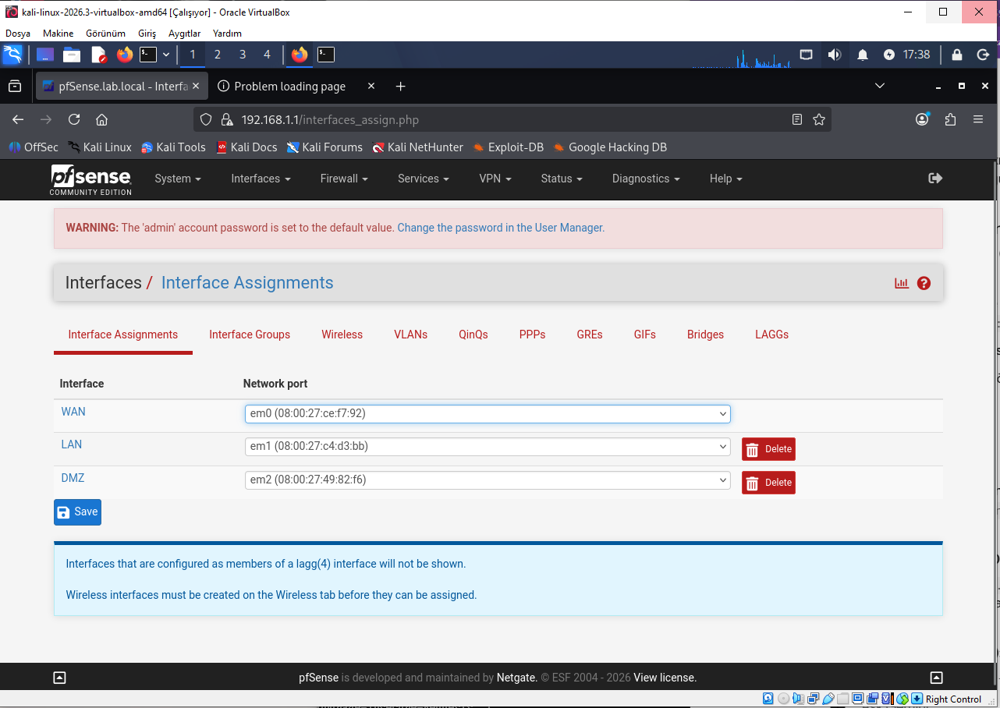
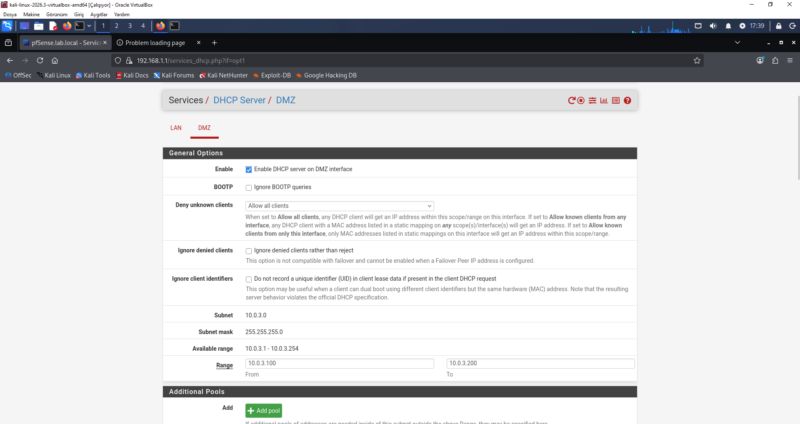
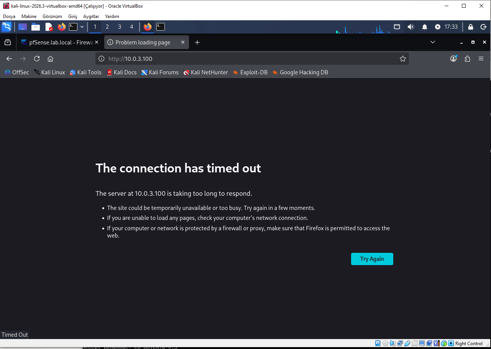

# bgt207-pfsense-firewall-lab
pfSense 3-interface network architecture (WAN, LAN, DMZ) configuration, HTTP packet filtering, DMZ segmentation, and firewall log analysis.
# BGT207 Ağ Güvenliği Laboratuvar Ödevi: pfSense ile DMZ ve Ağ Segmentasyonu

Bu ödevde VirtualBox üzerinde pfSense güvenlik duvarı kurarak üç farklı ağ bacağı (WAN, LAN ve DMZ) oluşturdum. Amacım, iç ağdaki (LAN) bir makine ile dışarıya açık servislerin bulunduğu güvenli bölge (DMZ) arasındaki paket trafiğini kontrol etmek ve güvenlik kuralları yazarak erişimi kısıtlamaktı.

---

## Kullandığım Sanal Makineler ve IP Yapılandırması

* **pfSense (Firewall):** Tüm ağ trafiğini yöneten ana ağ geçidi.
  * WAN: Dış internet bağlantısı (NAT)
  * LAN: `10.0.2.1/24` (İç ağ)
  * DMZ: `10.0.3.1/24` (İzole sunucu ağı)
* **Kali Linux (LAN İstemcisi):** Testleri yaptığım iç ağ makinesi (DHCP'den otomatik IP aldı).
* **Alpine Linux (DMZ Web Sunucusu):** DMZ bacağına bağladığım hafif Linux makinesi (`10.0.3.100` IP'sini aldı). Üzerinde 80 portunda basit bir HTTP servisi çalıştırdım.

---

## 1. Ağ Arayüzleri ve DHCP Ayarları

İlk olarak pfSense üzerinde sanal bağdaştırıcıları atadım: `em0` portunu WAN, `em1` portunu LAN ve `em2` portunu DMZ olarak tanımladım.

Makinelerin otomatik IP alabilmesi için hem LAN hem de DMZ bacaklarında DHCP sunucularını aktif ettim:
* LAN tarafı `10.0.2.10 - 10.0.2.100` aralığında IP dağıtıyor.
* DMZ tarafı `10.0.3.10 - 10.0.3.100` aralığında IP dağıtıyor.

---

## 2. Varsayılan Erişim Testi (Kural Öncesi)

Alpine makinesinde `nc` kullanarak 80 portundan web yayını başlattım. pfSense üzerinde varsayılan olarak LAN'dan her yere çıkış açık olduğu için (`Default allow LAN to any rule`), Kali Linux makinemden Firefox'u açıp `http://10.0.3.100` adresine gittiğimde sayfaya sorunsuz erişebildim:

---

## 3. Güvenlik Duvarı Engelleme Kuralı ve Testi

İç ağdan DMZ üzerindeki web servisine yetkisiz erişimi engellemek için pfSense paneline girip **Firewall -> Rules -> LAN** sekmesine gittim. En üst sıraya şu engelleme kuralını ekledim:
* **Action:** `Block`
* **Interface:** `LAN`
* **Protocol:** `TCP`
* **Source:** `LAN net`
* **Destination:** `10.0.3.100`
* **Destination Port:** `80 (HTTP)`
* **Log:** İşaretlendi (Engellenen paketlerin kaydını tutmak için)

Kuralı kaydedip aktif ettikten sonra Kali Linux üzerinden tekrar `http://10.0.3.100` adresine gitmeyi denedim. Sayfa artık açılmadı ve bağlantı zaman aşımına (Timeout) uğradı:

---

## 4. Güvenlik Duvarı Log Kayıtları

Yazdığım engelleme kuralının çalışıp çalışmadığını doğrulamak için pfSense arayüzünden **Status -> System Logs -> Firewall** sayfasına girdim. 

Logları
